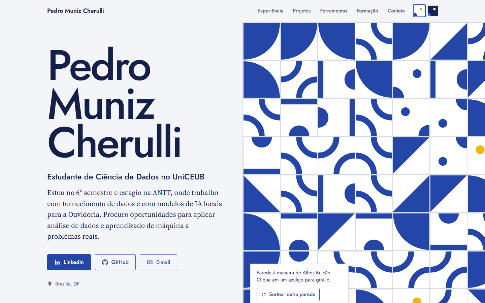
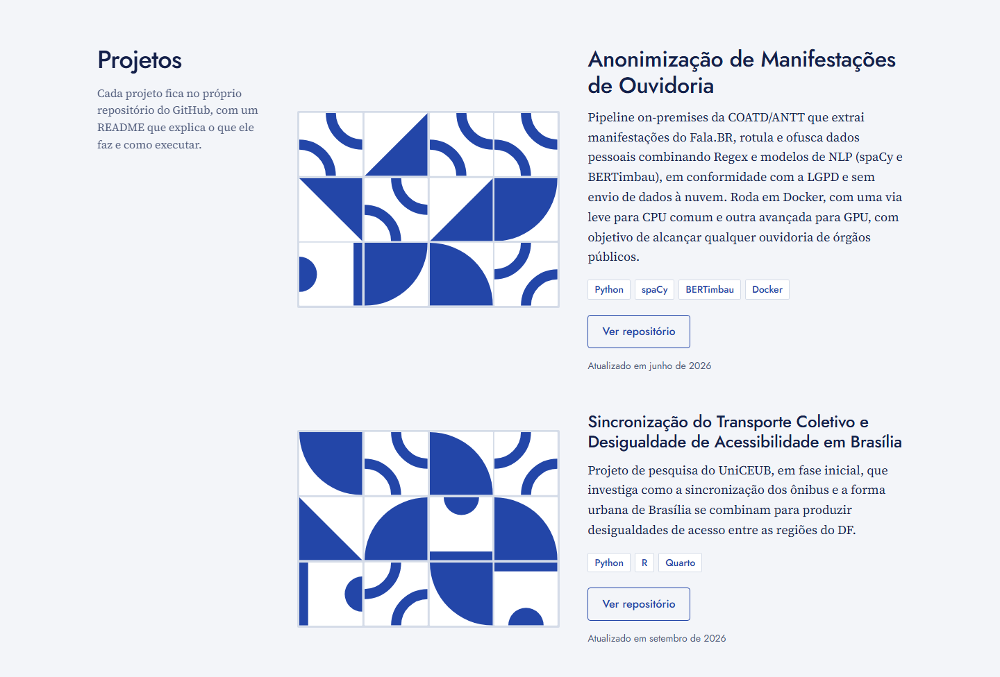
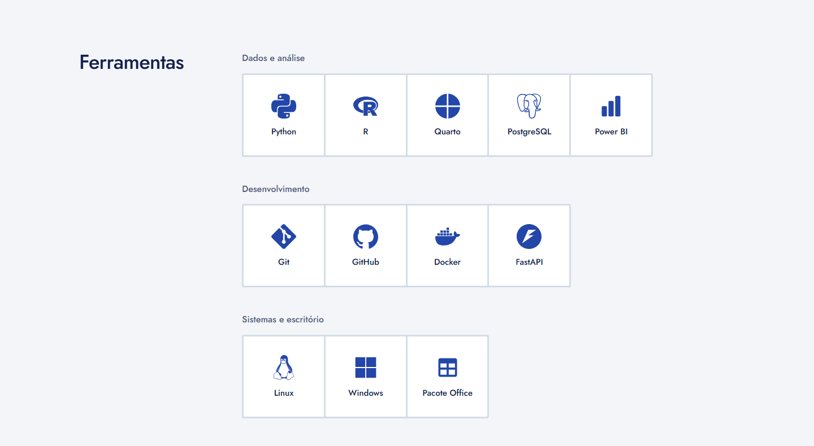
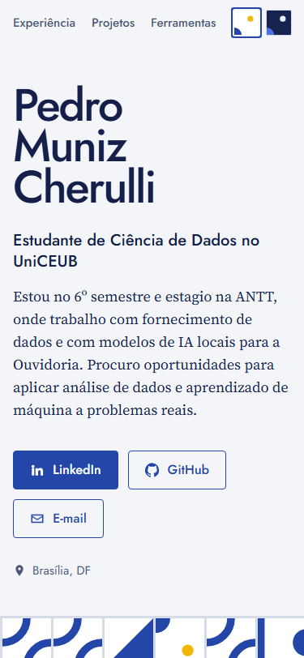

# Portfólio — Pedro Muniz Cherulli

Estudante de Ciência de Dados no UniCEUB e estagiário na ANTT.
Este repositório é o meu currículo online: uma página única, publicada com GitHub Pages,
que reúne experiência, projetos, ferramentas, formação e contato.
Ele também guarda um [revisor com IA](#revisor-com-gemini), que avalia esse currículo com o
Google Gemini e o compara com vagas.

**🔗 Site: https://pedromnzc.github.io/portfolio-pedromnzc/**

| Tema claro | Tema escuro |
|---|---|
|  |  |

---

## Sumário

- [Sobre o site](#sobre-o-site)
- [O que tem no site](#o-que-tem-no-site)
- [Funcionalidades](#funcionalidades)
- [Como atualizar o site](#como-atualizar-o-site)
  - [Experiência](#experiência)
  - [Projetos](#projetos)
  - [Ferramentas](#ferramentas)
  - [Formação](#formação)
  - [Idiomas](#idiomas)
  - [Contatos](#contatos)
- [Revisor com Gemini](#revisor-com-gemini)
  - [O que o relatório traz](#o-que-o-relatório-traz)
  - [Como funciona](#como-funciona)
  - [Como rodar](#como-rodar)
  - [Como adicionar uma vaga](#como-adicionar-uma-vaga)
  - [Como ajustar as respostas](#como-ajustar-as-respostas)
  - [Segurança](#segurança)
- [Como colaborar](#como-colaborar)
- [Meus projetos](#meus-projetos)
- [Contato](#contato)

---

## Sobre o site

O site é o ponto de partida do meu portfólio: apresenta quem eu sou e leva para os repositórios
dos meus projetos, cada um com o próprio README.

O visual é uma homenagem aos azulejos de **Athos Bulcão**, artista que desenhou painéis para
vários prédios de Brasília. Ele criava poucas peças simples e deixava os operários decidirem a
posição de cada uma, então cada parede saía diferente. No site é igual: a parede de azulejos da
abertura muda a cada visita.

## O que tem no site

| Seção | O que mostra |
|---|---|
| **Abertura** | Nome, um resumo sobre mim, botões de LinkedIn, GitHub e e-mail, e a parede de azulejos |
| **Experiência** | Estágio na ANTT e monitoria no Colégio Rogacionista |
| **Projetos** | Meus projetos, com descrição, tecnologias e link para o repositório |
| **Ferramentas** | As ferramentas que uso, cada uma num azulejo com o seu ícone |
| **Formação** | Graduação, ensino médio e o nível de cada idioma |
| **Contato** | E-mail, LinkedIn e GitHub |





## Funcionalidades

| Funcionalidade | Como funciona |
|---|---|
| 🧱 **Parede de azulejos** | A cada visita os azulejos são sorteados e montados peça por peça. Clicar em um azulejo faz ele girar, e o botão "Sortear outra parede" monta uma nova. |
| 🌗 **Tema claro e escuro** | Os dois azulejos no canto direito do topo trocam o tema: o branco, com um sol, deixa a página clara; o azul-noite, com uma lua, deixa a página escura. Na primeira visita o site segue o tema do computador ou do celular e, depois, lembra a escolha. |
| 📅 **Projetos atualizados** | Cada projeto mostra sozinho a data da última atualização no GitHub e ganha uma capa de azulejos própria, que gira ao passar o mouse. |
| ✉️ **Contato rápido** | O botão de e-mail abre o Gmail com a mensagem já endereçada para mim. |
| 📱 **Celular** | A página se ajusta a telas pequenas. |
| 🎞️ **Animações suaves** | Quem configurou o computador para reduzir movimento vê a página sem animações. |
| 🖨️ **Impressão** | Ao imprimir, sai só o currículo, sem o menu e sem a parede de azulejos. |



---

## Como atualizar o site

Cada parte do currículo fica numa lista própria, dentro da pasta `assets/js/`. Para mudar o
site, basta editar a lista, salvar e fazer **commit e push**. O site se atualiza em cerca de um
minuto.

| O que mudar | Arquivo |
|---|---|
| Experiência | `assets/js/experiencia.js` |
| Projetos | `assets/js/projetos.js` |
| Ferramentas | `assets/js/ferramentas.js` |
| Formação | `assets/js/formacao.js` |
| Idiomas | `assets/js/idiomas.js` |
| Contatos | `assets/js/contatos.js` |

> **Dica:** cada item da lista termina com vírgula. Ao copiar uma linha ou um bloco, copie a vírgula junto.
> Nas listas de experiência e formação, o item que estiver em cima aparece primeiro no site.

### Experiência

Abra `assets/js/experiencia.js`, copie um bloco inteiro (de `{` até `},`), cole na posição certa
e preencha:

```js
{
  periodo: "2025 a 2026",
  cargo: "Nome da função",
  empresa: "Onde foi",
  descricao: "Uma ou duas frases sobre o que você fazia.",
},
```

| Campo | O que colocar |
|---|---|
| `periodo` | Quando foi, ex.: `"2025 a 2026"` ou `"Desde 2026"`. |
| `cargo` | O nome da função. |
| `empresa` | A empresa, o órgão ou a escola. |
| `descricao` | *Opcional.* Uma ou duas frases sobre o que você fazia. |

### Projetos

Abra `assets/js/projetos.js`, copie um bloco inteiro, cole logo abaixo do último e preencha:

```js
{
  repo: "nome-do-repositorio",
  titulo: "Nome do projeto",
  descricao: "Uma ou duas frases sobre o que o projeto faz.",
  tecnologias: ["Python", "R"],
  imagem: "",
  demo: "",
  destaque: false,
},
```

| Campo | O que colocar |
|---|---|
| `repo` | O nome do repositório no GitHub. Se ele for de outra conta ou organização, use `dono/nome` (ex.: `COATD-Ouvidoria-ANTT/coatd-anonimizacao-publico`). |
| `titulo` | O nome do projeto como deve aparecer no site. |
| `descricao` | Uma ou duas frases sobre o projeto. |
| `tecnologias` | As tecnologias usadas, entre aspas e separadas por vírgula. |
| `imagem` | *Opcional.* O caminho de um print do projeto, ex.: `"assets/img/meu-projeto.png"`. Sem imagem, o projeto ganha uma capa de azulejos. |
| `demo` | *Opcional.* O link de uma versão publicada do projeto. |
| `destaque` | `true` para mostrar o projeto em tamanho grande no topo da seção. Use em só um. |

### Ferramentas

Abra `assets/js/ferramentas.js` e, no grupo certo, adicione uma linha com o nome da ferramenta,
na posição em que ela deve aparecer:

```js
{ nome: "Jupyter" },
```

O ícone é encontrado sozinho no [Simple Icons](https://simpleicons.org) a partir do nome. Se o
nome do ícone lá for diferente, informe-o em `icone`:

```js
{ nome: "Pacote Office", icone: "office" },
```

Para criar um grupo novo, copie um bloco inteiro de grupo e troque o título:

```js
{
  grupo: "Notebooks",
  ferramentas: [
    { nome: "Jupyter" },
  ],
},
```

> Se o ícone não for encontrado, o azulejo aparece só com o nome da ferramenta.

### Formação

Abra `assets/js/formacao.js`, copie um bloco inteiro, cole na posição certa e preencha:

```js
{
  periodo: "2024 a 2027",
  curso: "Nome do curso",
  instituicao: "Onde, e a situação: ex. UniCEUB, graduação em andamento",
},
```

| Campo | O que colocar |
|---|---|
| `periodo` | Quando foi, ex.: `"2024 a 2027"`. |
| `curso` | O nome do curso. |
| `instituicao` | A instituição e a situação, ex.: `"UniCEUB, graduação em andamento"`. |
| `descricao` | *Opcional.* Uma ou duas frases sobre o curso. |

### Idiomas

Abra `assets/js/idiomas.js` e adicione uma linha com o idioma e o nível:

```js
{ idioma: "Francês", nivel: "Básico" },
```

Cada idioma tem 4 azulejos, e o nível define quantos ficam preenchidos:

| Nível | Azulejos preenchidos |
|---|---|
| Básico | 1 de 4 |
| Intermediário | 2 de 4 |
| Avançado | 3 de 4 |
| Nativo | 4 de 4 |

Para subir de nível, troque só o texto, por exemplo de `"Intermediário"` para `"Avançado"`.

### Contatos

Os contatos aparecem como botões na abertura e na seção Contato. Abra `assets/js/contatos.js` e
adicione uma linha com o nome e o link:

```js
{ nome: "Instagram", link: "https://www.instagram.com/seu-usuario/" },
```

Para um endereço de e-mail, use `email` no lugar de `link`. O botão abre o Gmail com a mensagem
já endereçada, e o primeiro e-mail da lista também aparece em destaque na seção Contato:

```js
{ nome: "E-mail", email: "seu-email@gmail.com" },
```

| Campo | O que colocar |
|---|---|
| `nome` | O texto do botão, ex.: `"Instagram"`. |
| `link` | O endereço da página. |
| `email` | Use no lugar de `link` para um endereço de e-mail. |
| `destaque` | *Opcional.* `true` deixa o botão preenchido na abertura. Use em só um. |
| `icone` | *Opcional.* O nome do ícone no Simple Icons, só se for diferente do nome do contato. |

> Se o ícone não for encontrado, o botão aparece só com o texto.

---

## Revisor com Gemini

O revisor usa o Google Gemini para avaliar o meu currículo como um recrutador faria e para
comparar o currículo com vagas. Ele lê as mesmas listas que alimentam o site e gera um
relatório em HTML.

O revisor roda no meu computador, quando eu quero uma avaliação. Ele não faz parte do site e
não muda nada sozinho: o Gemini só sugere, e eu decido o que aplicar.

### O que o relatório traz

| Parte | O que mostra |
|---|---|
| **Revisão do currículo** | A primeira impressão de um recrutador, os pontos fortes, os riscos na triagem, sugestões por seção com o texto pronto para colar, palavras-chave e os próximos passos. |
| **Comparação com vagas** | Uma nota de aderência de 0 a 100 para cada vaga, o que já atendo e o que falta em cada requisito, o que adicionar à experiência a curto e médio prazo, e em qual vaga tenho mais chances. |

Exemplo do ranking de uma avaliação, com as três vagas fictícias que vêm no repositório:

| Posição | Vaga | Aderência | Chance de ser chamado |
|---|---|---|---|
| 1 | Estágio em Ciência de Dados | 85 | Alta |
| 2 | Engenharia de Software Júnior (Back-end) | 60 | Média |
| 3 | Cozinheiro(a) de Linha | 0 | Baixa |

A nota é calculada com pesos fixos: requisitos obrigatórios valem 60 pontos, diferenciais 20 e
nível e contexto da vaga 20. Uma ferramenta que aparece só na lista, sem projeto que a use,
conta como requisito parcial, não como atendido.

### Como funciona

```
assets/js/*.js (menos o main.js) ─┐
inputs/vagas/*.md ────────────────┼─▶ Gemini ─▶ outputs/render/inputs/revisor/revisor.html
inputs/revisor/instrucoes_*.md ───┘
```

O `main.js` fica de fora porque só desenha a página; as informações do currículo estão nos
outros arquivos de `assets/js/`. O Gemini é consultado duas vezes, uma para cada parte do
relatório, com o modelo `gemini-3.1-flash-lite`, do plano gratuito.

| Arquivo | Para que serve |
|---|---|
| `inputs/revisor/revisor.qmd` | Documento Quarto que lê os arquivos, consulta o Gemini e monta o relatório. |
| `inputs/revisor/instrucoes_revisao.md` | O que o Gemini deve fazer na revisão do currículo. |
| `inputs/revisor/instrucoes_vagas.md` | O que o Gemini deve fazer na comparação com vagas. |
| `inputs/revisor/_metadata.yml` | O formato do relatório: HTML num arquivo só, com sumário e seções numeradas. |
| `inputs/revisor/tema-escuro.scss` | As cores e fontes do site no relatório, que abre no tema escuro. |
| `inputs/vagas/` | As vagas usadas na comparação, uma por arquivo. |
| `_quarto.yml` | Diz ao Quarto para renderizar só o revisor e salvar o resultado em `outputs/render/`. |
| `.env.example` | Modelo do arquivo onde fica a chave da API. |

### Como rodar

**Você vai precisar de:**

- R 4.6 e o RStudio, que já traz o Quarto.
- Python 3.14. No Windows, o documento procura o Python pelo comando `py -3.14`; se a sua
  versão for outra, troque o número nessa linha do `revisor.qmd`.
- Uma chave da API do Gemini, criada de graça em
  [aistudio.google.com/apikey](https://aistudio.google.com/apikey).

**Passo a passo:**

1. Copie o arquivo `.env.example` para `.env`, na raiz do repositório, e preencha a chave:

   ```
   GEMINI_API_KEY=sua-chave
   ```

2. Na primeira vez, instale no R os pacotes que o Quarto usa para rodar o documento:

   ```r
   install.packages(c("knitr", "rmarkdown"))
   ```

3. Renderize o relatório. No RStudio, abra `inputs/revisor/revisor.qmd` e clique em
   **Render**. Pelo terminal, na raiz do repositório:

   ```bash
   quarto render
   ```

   O Quarto que vem com o RStudio não fica disponível no terminal. Se o comando `quarto` não
   for encontrado, use o botão do RStudio ou instale o Quarto em [quarto.org](https://quarto.org).

4. Abra `outputs/render/inputs/revisor/revisor.html` no navegador.

Na primeira vez o render demora mais, porque cria o ambiente Python (`.venv`) e instala os
pacotes `google-genai` e `python-dotenv`. Depois disso, cada avaliação leva cerca de 40
segundos. As respostas mudam um pouco a cada render, porque o Gemini não responde sempre
igual.

> Se aparecer o erro **503 (high demand)**, o modelo está sobrecarregado. Espere alguns minutos
> e renderize de novo, ou troque o modelo (veja abaixo).

### Como adicionar uma vaga

Crie um arquivo `.md` em `inputs/vagas/`, com um nome que descreva a vaga (ex.:
`analista-de-dados-empresa.md`), e cole o anúncio neste formato:

```markdown
# Título da vaga

- **Empresa:** Nome da empresa
- **Local:** Cidade, presencial, híbrido ou remoto

## Atividades

- O que a pessoa vai fazer.

## Requisitos obrigatórios

- O que a vaga exige.

## Diferenciais

- O que conta a favor, mas não é obrigatório.
```

A comparação lê todos os arquivos da pasta. Para tirar uma vaga da avaliação, apague o arquivo
ou mova-o para fora de `inputs/vagas/`.

### Como ajustar as respostas

| O que mudar | Onde |
|---|---|
| O que o Gemini analisa e o formato da resposta | `inputs/revisor/instrucoes_revisao.md` e `inputs/revisor/instrucoes_vagas.md`, em português, sem mexer no código |
| O modelo do Gemini | A linha `MODELO = "gemini-3.1-flash-lite"` no `revisor.qmd`. Os modelos gratuitos estão na [página de preços da API](https://ai.google.dev/gemini-api/docs/pricing). |
| As cores e fontes do relatório | `inputs/revisor/tema-escuro.scss` |

### Segurança

- **A chave nunca vai para o repositório.** Ela fica só no `.env`, que o `.gitignore`
  bloqueia. O site não tem chave nenhuma, porque o revisor não roda no navegador.
- **Os relatórios ficam só no computador.** A pasta `outputs/` também é ignorada pelo git,
  então a avaliação do meu currículo não é publicada.
- **O Gemini só sugere.** Nenhuma mudança vai para o site sem eu revisar e fazer o commit.
- **Texto de fora é tratado como dado.** As instruções mandam o Gemini ignorar qualquer
  ordem escrita dentro do currículo ou de uma vaga colada, para que um anúncio mal-intencionado
  não mude o comportamento do revisor.
- **O que é enviado ao Gemini:** o conteúdo do currículo, que já é público no site, e as vagas
  da pasta. Não coloque nas vagas dados pessoais de outras pessoas.

---

## Como colaborar

Toda mudança segue o mesmo caminho, para que a `main` (que é o site publicado) só receba
código revisado:

1. **Issue:** descreve o que precisa ser feito e quando está pronto.
2. **Branch:** criada a partir da `main`, com um prefixo que diz o tipo da mudança.
3. **Commits:** pequenos, com a mensagem começando pelo mesmo prefixo
   (ex.: `feat: adiciona .scss que cria tema escuro no .html`).
4. **Pull request:** com `Closes #N` na descrição, para fechar a issue no merge.
5. **Revisão e merge** na `main`.

| Prefixo | Quando usar | Exemplo neste repositório |
|---|---|---|
| `feat/` | Funcionalidade nova | `feat/revisor-curriculo`, `feat/comparacao-vagas` |
| `chore/` | Estrutura e configuração | `chore/estrutura-projeto` |
| `style/` | Visual, sem mudar o funcionamento | `style/tema-relatorio` |
| `docs/` | Documentação | `docs/revisor-gemini` |

---

## Meus projetos

| Projeto | Descrição | Tecnologias |
|---|---|---|
| [Anonimização de Manifestações de Ouvidoria](https://github.com/COATD-Ouvidoria-ANTT/coatd-anonimizacao-publico) | Pipeline on-premises que ofusca dados pessoais em manifestações do Fala.BR, em conformidade com a LGPD | Python, spaCy, BERTimbau, Docker |
| [Transporte Coletivo e Acessibilidade em Brasília](https://github.com/pedromnzc/brasilia-transit-equity) | Pesquisa (UniCEUB, fase inicial) sobre sincronização dos ônibus e desigualdade de acesso no DF | Python, R, Quarto |

## Contato

- **LinkedIn:** [pedro-muniz-cherulli](https://www.linkedin.com/in/pedro-muniz-cherulli-04b519306/)
- **GitHub:** [@pedromnzc](https://github.com/pedromnzc)
- **E-mail:** pedromunizcherulli3@gmail.com
